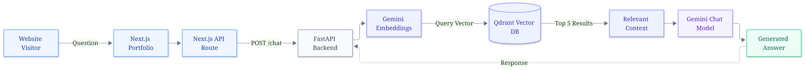
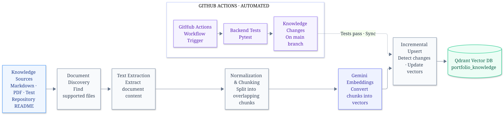

# Personal Portfolio & RAG Assistant

**Live Portfolio:** [gaurabkus.dev](https://gaurabkus.dev)  
**GitHub:** [Gaurab012](https://github.com/Gaurab012)

A personal portfolio website enhanced with an AI-powered Retrieval-Augmented Generation (RAG) assistant.

The portfolio showcases my profile, technical skills, projects, education, and experience. Visitors can interact with an integrated AI assistant to ask questions about my background and work. The assistant retrieves relevant information from a dedicated portfolio knowledge base and uses it to generate context-aware responses.

The project combines a Next.js frontend, a Python FastAPI backend, Google Gemini for embeddings and response generation, and Qdrant for vector storage and similarity search.

---

## Features

- **Personal Portfolio:** Responsive website showcasing my profile, skills, projects, education, and experience.
- **AI Portfolio Assistant:** Answers visitor questions about my background and projects using information from the portfolio knowledge base.
- **Retrieval-Augmented Generation:** Combines semantic search with LLM-based response generation to provide context-aware answers.
- **Knowledge Base Management:** Uses Markdown, text, and PDF documents as knowledge sources.
- **Incremental Knowledge Synchronization:** Detects document changes and updates the corresponding records in Qdrant.
- **Automated Workflow:** GitHub Actions automates backend testing and knowledge synchronization.
- **Contact Form:** Handles visitor enquiries through the Resend email API.
- **Backend Security:** Shared-token authentication protects frontend-to-backend chat requests.
- **Request Monitoring:** Includes request IDs, request-duration logging, input validation, and error handling.

---

## System Architecture

The application consists of two primary workflows: processing visitor questions and preparing the knowledge base used by the RAG assistant.

### Figure 1. Chat Request Flow



*Illustrates the end-to-end flow of a visitor's question through the Next.js frontend, FastAPI backend, Gemini embedding model, Qdrant vector database, and response generation pipeline.*

**Request processing:**

1. A visitor submits a question through the portfolio chat interface.
2. The Next.js API route validates the request and forwards it to the FastAPI backend.
3. The backend generates an embedding for the visitor's question.
4. Qdrant performs similarity search against the portfolio knowledge collection.
5. Relevant knowledge chunks are retrieved and passed to the Gemini chat model.
6. The generated response is returned through FastAPI and the Next.js API route to the visitor.

Common conversational messages, such as greetings, can be handled separately without executing the complete retrieval pipeline.

### Figure 2. Knowledge Ingestion and Synchronization



*Illustrates the document ingestion pipeline, including text extraction, chunking, embedding generation, incremental vector updates, and automated synchronization through GitHub Actions.*

**Knowledge ingestion process:**

1. **Document Discovery:** Identifies supported Markdown, text, and PDF files from configured knowledge sources.
2. **Text Extraction:** Extracts readable content from the discovered documents.
3. **Normalization and Chunking:** Normalizes the extracted content and divides it into smaller, overlapping chunks.
4. **Embedding Generation:** Uses Google Gemini to convert text chunks into vector embeddings.
5. **Incremental Upsert:** Detects content changes and updates the corresponding vector records.
6. **Vector Storage:** Stores embeddings and associated metadata in the Qdrant `portfolio_knowledge` collection.

GitHub Actions automates backend testing and triggers knowledge synchronization when the configured conditions are satisfied.

---

## RAG Pipeline

The assistant follows a Retrieval-Augmented Generation workflow to answer questions using information stored in the portfolio knowledge base.

### 1. Document Discovery

The ingestion process discovers supported `.md`, `.txt`, and `.pdf` documents from the configured knowledge sources. Repository README files can also be included as knowledge sources.

### 2. Text Extraction and Chunking

Extracted text is normalized and divided into smaller, overlapping chunks.

The current configuration uses:

- **Maximum chunk size:** 1,200 characters
- **Target overlap:** 180 characters
- **Chunk boundaries:** Paragraph, line, sentence, and word boundaries are preferred where possible.

### 3. Embedding Generation

Google Gemini's configured embedding model converts each text chunk into a vector representation.

Source information is retained as metadata so retrieved content can be associated with its original document.

### 4. Vector Storage

Generated embeddings and their associated metadata are stored in the Qdrant `portfolio_knowledge` collection.

Similarity search uses cosine distance to identify relevant information.

### 5. Semantic Retrieval

When a visitor submits a portfolio-related question, the backend generates an embedding for the query and searches Qdrant for relevant knowledge chunks.

The retrieval configuration returns up to five relevant results.

### 6. Response Generation

The retrieved context and visitor's question are passed to the configured Gemini chat model.

The model generates a context-aware response grounded in the retrieved portfolio information and is instructed to acknowledge when relevant information is unavailable.

### 7. Incremental Synchronization

The ingestion process uses content fingerprints and stable point identifiers to avoid unnecessarily reprocessing unchanged documents.

When source content changes, the corresponding vector records are updated. Outdated records can also be removed when their source documents are deleted.

---

## Technology Stack

| Layer | Technologies |
|---|---|
| Frontend | Next.js, React, TypeScript |
| Styling | Tailwind CSS |
| Frontend API | Next.js Route Handlers |
| Backend | Python, FastAPI, Pydantic |
| LLM and Embeddings | Google Gemini API |
| Vector Database | Qdrant |
| Email Service | Resend |
| Testing | Pytest |
| CI/CD and Automation | GitHub Actions |
| Deployment | Vercel, FastAPI hosting, Qdrant Cloud |

---

## Repository Structure

```text
portfolio/
│
├── knowledge/
│   ├── projects/
│   ├── experience.md
│   ├── profile.md
│   ├── skills.md
│   └── resume.pdf
│
├── public/
│   ├── Gemini_Qdrant_Portfolio_Chat_Pipeline.png
│   ├── Qdrant_Knowledge_Sync_Pipeline.png
│   ├── gaurab.png
│   └── resume.pdf
│
├── rag-backend/
│   ├── app/
│   ├── tests/
│   ├── requirements.txt
│   └── requirements-dev.txt
│
├── src/
│   ├── app/
│   │   └── api/
│   │       ├── chat/
│   │       └── contact/
│   │
│   └── components/
│
├── .github/
│   └── workflows/
│
├── AGENTS.md
├── compose.yaml
├── eslint.config.mjs
├── next.config.ts
├── package.json
├── package-lock.json
├── README.md
└── tsconfig.json
```

*The structure above highlights the main project directories and files.*

### Key Backend Components

| Component | Responsibility |
|---|---|
| `main.py` | FastAPI application and chat endpoint |
| `retrieval.py` | Query embedding generation and Qdrant retrieval |
| `vector_store.py` | Vector database operations and knowledge synchronization |
| `ingestion.py` | Document discovery and text extraction |
| `chunking.py` | Text normalization and chunk generation |
| `request_middleware.py` | Request identification and duration logging |

---

## Testing and Automation

Backend tests are maintained in the `rag-backend/tests/` directory using Pytest.

GitHub Actions automates the testing and knowledge synchronization workflow.

The workflow is designed to:

- Run backend tests on configured GitHub events.
- Detect changes to relevant knowledge files and repository documentation.
- Trigger knowledge synchronization when configured conditions are met.
- Support manual execution through GitHub Actions, if enabled.

This helps keep the Qdrant knowledge base aligned with the portfolio's source documents.

---

## Deployment Architecture

The application uses separate services for the frontend, backend, vector database, and external AI and email APIs.

| Service | Responsibility |
|---|---|
| Vercel | Hosts the Next.js portfolio frontend |
| FastAPI Hosting | Runs the Python backend |
| Qdrant Cloud | Stores and retrieves portfolio embeddings |
| Google Gemini API | Handles embedding generation and response generation |
| GitHub Actions | Automates testing and knowledge synchronization |
| Resend | Handles contact form email delivery |

The Next.js frontend communicates with the FastAPI backend through a server-side API route.

Shared-token authentication protects frontend-to-backend chat requests. API keys and credentials are maintained as environment variables or deployment secrets and are not exposed in client-side code.

---

## Connect

- **Portfolio:** [gaurabkus.dev](https://gaurabkus.dev)
- **GitHub:** [Gaurab012](https://github.com/Gaurab012)
- **LinkedIn:** [Gaurab Kushwaha](https://www.linkedin.com/in/gaurab-kushwaha-837237285/)
